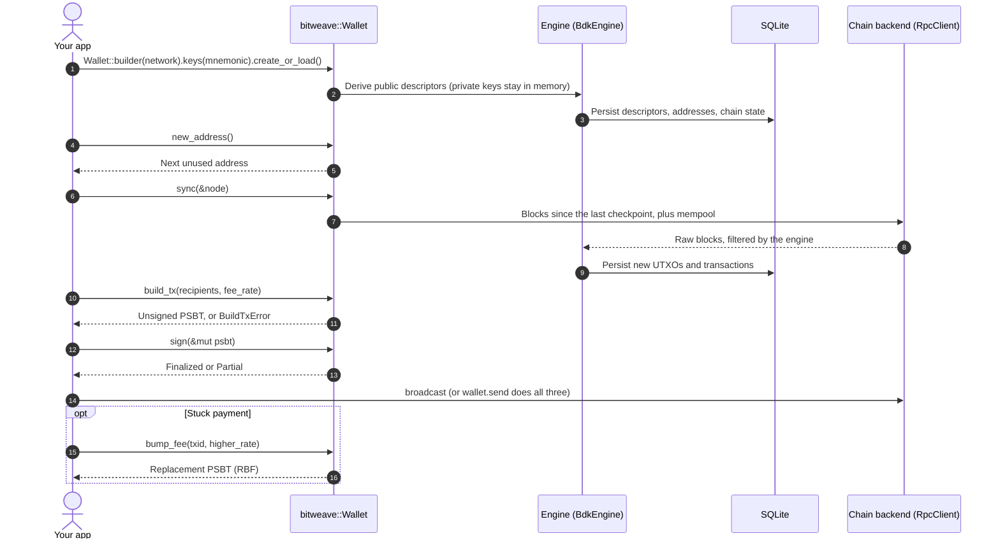
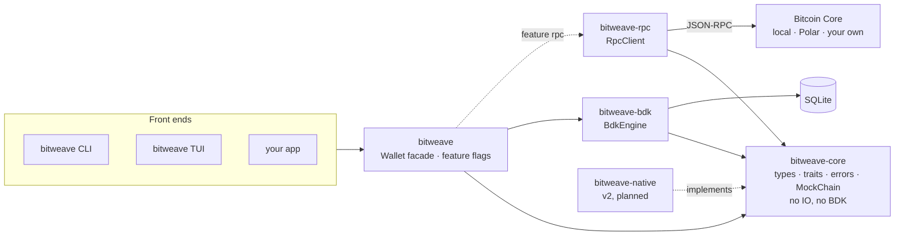

<p align="center">
  <picture>
    <source media="(prefers-color-scheme: dark)" srcset="docs/assets/bitweave-dark.svg"/>
    
  </picture>
</p>

<h3 align="center">One Rust toolkit for Bitcoin, from on-chain to every layer above it.</h3>

<p align="center">
  Non-custodial wallets · Typed errors · Pluggable engines and chain backends · CLI and terminal UI<br/>
  <b>A Cargo workspace for the bitweave library, its Bitcoin Core backend and the <code>bitweave</code> app built on it.</b>
</p>

<p align="center">
  <a href="https://crates.io/crates/bitweave"></a>
  <a href="https://docs.rs/bitweave"></a>
  <a href="https://github.com/Zunetra/bitweave/actions/workflows/ci.yml"></a>
  <a href="./LICENSE"></a>
  
  
  
</p>

---

## What bitweave does

Every Bitcoin app ends up rewriting the same wallet logic: key management, address derivation, UTXO tracking, coin selection, PSBT building and signing, fee bumping and chain sync. Each rewrite is a fresh chance to lose someone's money.

bitweave puts that logic behind one typed Rust API, so apps don't have to rewrite it:

- **Non-custodial:** keys stay with the caller. The database never stores private keys, and the engine only ever sees public descriptors.
- **Pluggable:** the wallet engine and the chain backend are traits. Today's engine wraps `bdk_wallet`; a native engine is planned in [docs/v2](docs/v2/README.md).
- **Typed errors:** one error enum per operation, with structured data such as `InsufficientFunds { needed, available }`.
- **Works offline:** addresses, balances (as of the last sync) and signing never need a node.
- **Every address kind:** legacy, nested SegWit, native SegWit (BIP84, the default) and Taproot.
- **Tested:** unit tests, a public API suite against an in-memory chain, doc examples, and end-to-end tests against a real regtest `bitcoind`.

Today bitweave covers on-chain Bitcoin. Lightning, Ark and Fedimint come next, each as its own crate behind a feature flag (see [Roadmap](#roadmap)).

**Contents:** [How it works](#how-it-works) · [Crates](#crates) · [Architecture](#architecture) · [Repository layout](#repository-layout) · [Quick start](#quick-start) · [Using the library](#using-the-library) · [Examples](#examples) · [Configuration](#configuration) · [Rules worth knowing](#rules-worth-knowing) · [Testing](#testing) · [Roadmap](#roadmap) · [Documentation](#documentation)

## How it works



## Crates

| Crate | crates.io | What it is |
|---|---|---|
| [`bitweave`](crates/bitweave) | [](https://crates.io/crates/bitweave) | **Start here.** `Wallet<E>`, `WalletBuilder`, re-exports of everything below, and the feature flags |
| [`bitweave-core`](crates/bitweave-core) | [](https://crates.io/crates/bitweave-core) | Domain types, the `WalletEngine` and chain traits, one error enum per operation, the `MockChain` test kit. No IO, no BDK |
| [`bitweave-bdk`](crates/bitweave-bdk) | [](https://crates.io/crates/bitweave-bdk) | `BdkEngine`: implements `WalletEngine` with `bdk_wallet` and SQLite |
| [`bitweave-rpc`](crates/bitweave-rpc) | [](https://crates.io/crates/bitweave-rpc) | `RpcClient`: `BlockSource`, `Broadcaster` and `FeeEstimator` over Bitcoin Core JSON-RPC |
| [`bitweave-cli`](crates/bitweave-cli) | [](https://crates.io/crates/bitweave-cli) | The `bitweave` binary: every command plus a terminal UI, built only on the public `bitweave` API |

### Feature flags (`bitweave`)

| Feature | Default | Enables |
|---|---|---|
| `rpc` | yes | `bitweave::rpc`, the Bitcoin Core backend |
| `serde` | no | `Serialize`/`Deserialize` on the public data types (the CLI's `--json` uses it) |

### Feature flags (`bitweave-cli`)

| Feature | Default | Enables |
|---|---|---|
| `local-node` | yes | `--node local` and `tui --demo`: the app runs its own regtest `bitcoind`, downloaded at build time |

## Architecture



**The dependency rule:** arrows point inward. `bitweave-core` never imports an adapter, a database, a network client or BDK, and the compiler enforces that because it has no such dependencies. Design, data flows, error strategy and TUI structure: [docs/architecture.md](docs/architecture.md).

| Trait | Purpose | Implementations |
|---|---|---|
| `WalletEngine` | Wallet state machine: addresses, balance, UTXOs, build, sign, sync | `BdkEngine` |
| `BlockSource` | Blocks by height or hash, plus mempool | `RpcClient`, `MockChain`, your own |
| `Broadcaster` | Relay a signed transaction | `RpcClient`, `MockChain` |
| `FeeEstimator` | Fee rate for a confirmation target | `RpcClient`, `MockChain` |

**Stack:** Rust 2024 · `rust-bitcoin` 0.32 · `bdk_wallet` 3.2 · SQLite (`rusqlite`) · `bitcoincore-rpc` · `clap` · `ratatui` · Argon2 + AES-GCM · `corepc-node` (Bitcoin Core 29.0) · `proptest`

## Repository layout

```
.
├── crates
│   ├── bitweave              # Public facade: Wallet<E>, builder, re-exports
│   │   ├── examples          # quickstart, custom_backend, watch_only_signing, error_handling, bump_fee, regtest
│   │   └── tests             # Public API suite (MockChain) and regtest end-to-end suite
│   ├── bitweave-core         # Types, traits, errors, MockChain; no IO
│   ├── bitweave-bdk          # BdkEngine on bdk_wallet + SQLite
│   ├── bitweave-rpc          # Bitcoin Core RPC backend
│   └── bitweave-cli          # The `bitweave` binary
│       ├── src/tui           # Terminal UI: screens, worker thread, theme, startup banner
│       └── tests             # Runs the real binary end to end
├── docs
│   ├── assets                # Wordmark
│   ├── architecture.md
│   ├── CLI.md
│   ├── TUI.md
│   └── v2                    # Plan for a native engine without BDK
├── scripts
│   └── regtest.sh            # One-word regtest workflows (demo, demo-tui, start, ...)
├── .cargo/config.toml        # `cargo bitweave`, `cargo alice`, `cargo bob` shortcuts
├── .github/workflows/ci.yml  # fmt, clippy, tests, examples
├── .env.example              # Every BITWEAVE_* setting, documented
├── Cargo.toml                # Workspace: shared versions and metadata
└── LICENSE
```

## Quick start

**You need:** Rust 1.88 or newer (`rustup update stable`), a C compiler (`build-essential` on Ubuntu/Debian, Xcode tools on macOS) because SQLite is compiled in, and internet on the first build.

```bash
git clone https://github.com/Zunetra/bitweave.git && cd bitweave
cargo bitweave tui --demo
```

The first build downloads Bitcoin Core 29.0 once (for the demo node and tests), so it takes a few minutes. Then a throwaway regtest node starts, a wallet is created with fresh recovery words, and the terminal UI opens. Press `f` for coins, `3` to send, `m` to mine a block, `?` for every key and `q` to quit (which also stops the node). Nothing is kept.

<details>
<summary>Two wallets pay each other</summary>

Two wallets on one private regtest network, with nothing to install. `alice` and `bob` are only example names.

**In the TUI:**

1. `cargo bitweave tui`, type a name, `enter`, then `enter` three times to create it.
2. `f` for coins.
3. `w`, then `n`, to name and create a second wallet. `w` again to switch back.
4. `3` (Send), `enter`, `ctrl+w` to fill in your other wallet's address, an amount (`25000` or `0.5btc`), `enter`, `y`.
5. `m` to confirm it, then `w` to switch over and see it arrive.

Or one wallet per terminal: `cargo bitweave -w alice tui` and `cargo bitweave -w bob tui` (`./scripts/regtest.sh demo-tui alice bob` prints the steps). See [docs/TUI.md](docs/TUI.md#two-wallets-paying-each-other).

**On the command line:** `./scripts/regtest.sh demo alice bob` in one go, or step by step:

```bash
cargo bitweave -w alice init                 # fresh recovery words
cargo bitweave -w bob init
cargo bitweave -w alice mine 101             # coins for alice
cargo bitweave -w bob address                # copy bob's address
cargo bitweave -w alice send <bob's address> 0.0025btc
cargo bitweave -w alice mine 1               # confirm it
cargo bitweave -w bob history                # +250,000 sat, confirmed
```

</details>

### Running the app

The program is `bitweave`. In this repo:

```bash
cargo bitweave <command>             # the default wallet, e.g. cargo bitweave wallets
cargo bitweave -w <name> <command>   # a wallet by name
cargo alice <command>                # shortcut for -w alice (likewise cargo bob)
```

Elsewhere: `./target/debug/bitweave <command>`, or install it with `cargo install --path crates/bitweave-cli` (`cargo install bitweave-cli` once published). Cargo's own flags go before the alias (`cargo --offline bitweave init`).

### Syncing with a node

A wallet syncs by reading blocks from a Bitcoin Core node over RPC, and broadcasts through it. Pick the node with `--node` or `BITWEAVE_NODE`:

| Node | When | Setup |
|---|---|---|
| `local` | the default on regtest | none: one regtest `bitcoind` shared by all your wallets, started on demand and stopped when the last program using it exits (`./scripts/regtest.sh start` keeps it up) |
| `polar` | [Polar](https://lightningpolar.com) | `--node polar`; its RPC defaults are filled in and its wallets live in `.bitweave/polar`. See [Connecting to Polar](docs/CLI.md#connecting-to-polar) |
| `external` | your own `bitcoind`, or any non-regtest network | set `BITWEAVE_RPC_URL` and either `BITWEAVE_RPC_COOKIE` or `BITWEAVE_RPC_USER` / `BITWEAVE_RPC_PASS` |
| `none` | offline on purpose | none |

If the node cannot be reached, the TUI opens **OFFLINE**, shows why on the dashboard and keeps retrying (with Polar, `L` switches to the local node for that session).

## Using the library

```toml
[dependencies]
bitweave = "0.1"
# or, before the first release:
# bitweave = { git = "https://github.com/Zunetra/bitweave" }
```

```rust
use std::env;

use bitweave::bitcoin::{Amount, FeeRate, Network};
use bitweave::rpc::{RpcAuth, RpcClient};
use bitweave::{KeySource, MnemonicLength, Recipient, Wallet, generate_mnemonic};

// Node location comes from the environment; see .env.example for per-network defaults.
let url = env::var("BITWEAVE_RPC_URL")?;
let cookie = env::var("BITWEAVE_RPC_COOKIE")?;
let node = RpcClient::new(&url, RpcAuth::Cookie(cookie.into()))?;

let mnemonic = generate_mnemonic(MnemonicLength::Words12)?;   // fresh every call
let mut wallet = Wallet::builder(Network::Regtest)
    .keys(KeySource::mnemonic(mnemonic.as_str()))
    .database("wallet.sqlite")
    .create_or_load()?;

let receive = wallet.new_address()?;          // next unused address (BIP84 by default)
wallet.sync(&node)?;                          // pull blocks and mempool
let balance = wallet.balance();               // confirmed, unconfirmed, immature

let to = "bcrt1q...".parse()?;
let fee_rate = FeeRate::from_sat_per_vb_u32(2);
let txid = wallet.send([Recipient::new(to, Amount::from_sat(50_000))], fee_rate, &node)?;
```

Handling errors by type:

```rust
match wallet.build_tx(recipients, fee_rate) {
    Ok(psbt) => { /* sign and broadcast */ }
    Err(BuildTxError::InsufficientFunds { needed, available }) => {
        println!("short by {}", needed - available);
    }
    Err(BuildTxError::WrongNetwork { address, expected }) => {
        println!("{address} is not a {expected} address");
    }
    Err(other) => return Err(other.into()),
}
```

| Method | Returns |
|---|---|
| `Wallet::builder(network).keys(..).database(..).create() / load() / create_or_load()` | `Wallet` |
| `.address_kind(kind)` on the builder | script type for a mnemonic's own addresses: `Legacy`, `NestedSegwit`, `Segwit` (default) or `Taproot`; ignored for explicit descriptors |
| `generate_mnemonic(length)` / `validate_mnemonic(phrase)` | fresh 12/15/18/21/24-word phrase / check one |
| `new_address()` / `reveal_next_address()` | next unused / always-fresh receive address |
| `balance()` | `Balance { confirmed, unconfirmed, immature }` |
| `list_utxos()` / `transactions()` / `tx_status(txid)` | coins / history / confirmation state |
| `build_tx(recipients, fee_rate)` / `build_tx_with(&TxRequest)` | unsigned PSBT |
| `sign(&mut psbt)` | `Finalized` or `Partial` |
| `bump_fee(txid, fee_rate)` | replacement PSBT (RBF) |
| `track_pending(&tx)` | count a signed, not-yet-broadcast transaction (offline payments) |
| `sync(&source)` | `SyncReport` |
| `send(recipients, fee_rate, &broadcaster)` | build, sign and broadcast in one call |

Any `BlockSource` works for `sync`: `rpc::RpcClient`, `testkit::MockChain` for tests, or your own (see `custom_backend` below). Every public item is documented: `cargo doc -p bitweave --open`, or [docs.rs/bitweave](https://docs.rs/bitweave).

## Examples

Each runs with no setup, and CI runs them all.

| Example | Shows |
|---|---|
| `quickstart` | create, receive, sync, balance, build, sign, send |
| `custom_backend` | writing your own `BlockSource`, a logging decorator, choosing a backend at runtime |
| `watch_only_signing` | a watch-only wallet builds, an offline wallet signs, PSBT as base64 |
| `error_handling` | matching on each typed error |
| `bump_fee` | replacing a stuck payment with a higher fee (RBF) |
| `regtest` | the full flow on Bitcoin Core (starts its own, or uses `BITWEAVE_RPC_URL`) |

```bash
cargo run -p bitweave --example quickstart
```

## Configuration

The app reads flags first, then variables already in your environment, then a `.env` in the directory you run it from (`cp .env.example .env`). Every setting is documented in [`.env.example`](.env.example).

| Variable | Flag | Default | What it does |
|---|---|---|---|
| `BITWEAVE_NETWORK` | `-n, --network` | `regtest` | `regtest`, `signet`, `testnet`, `testnet4`, `bitcoin` |
| `BITWEAVE_NAME` | `-w, --wallet` | the default wallet | which named wallet |
| `BITWEAVE_DATADIR` | `--datadir` | | a wallet directory by path instead of a name |
| `BITWEAVE_ENCRYPT` | `--encrypt` | off | password-protect the recovery words (required on mainnet) |
| `BITWEAVE_ALLOW_MAINNET` | `--allow-mainnet` | off | required for `--network bitcoin` |
| `BITWEAVE_WORDS` | `--words` | `12` | word count for new wallets |
| `BITWEAVE_ADDRESS_TYPE` | `--address-type` | `segwit` | `legacy`, `nested-segwit`, `segwit`, `taproot` |
| `BITWEAVE_NODE` | `--node` | `local` on regtest, else `external` | `local`, `polar`, `external`, `none` |
| `BITWEAVE_NODE_DIR` / `BITWEAVE_NODE_PORT` | `--node-dir` / `--node-port` | `.bitweave/regtest/node` / `18543` | the shared local node |
| `BITWEAVE_RPC_URL` | `--rpc-url` | localhost, network port | your Bitcoin Core |
| `BITWEAVE_RPC_COOKIE` | `--rpc-cookie` | `~/.bitcoin/<network>/.cookie` | its cookie file |
| `BITWEAVE_RPC_USER` / `BITWEAVE_RPC_PASS` | `--rpc-user` / `--rpc-pass` | | instead of the cookie |
| `BITWEAVE_MNEMONIC` / `BITWEAVE_PASSPHRASE` | | | for `restore`; throwaway wallets only |
| `BITWEAVE_REFRESH_SECS` | | `30` | TUI auto-sync interval, `0` turns it off |

Wallet data lives in `./.bitweave/<network>/wallets/<name>` of the directory you run it from.

## Rules worth knowing

These catch people out. The reasons are in [docs/architecture.md](docs/architecture.md).

- **Keys never reach the library's database.** BDK only sees public descriptors, and signing keys stay in memory with the caller.
- **The CLI's recovery words are plain text unless you encrypt them.** `--encrypt` stores them as `mnemonic.enc` (Argon2 + AES-GCM) instead of `mnemonic`. Mainnet requires it.
- **Mainnet is off until you ask for it.** `--network bitcoin` fails without `--allow-mainnet` or `BITWEAVE_ALLOW_MAINNET=true`.
- **An address type is fixed for a wallet's lifetime.** A restore must use the type the wallet was created with, or it finds no coins.
- **Balances are as of the last sync.** Addresses, balances and signing work offline; nothing changes until `sync`.
- **`bitweave-core` imports nothing with IO.** New engines and backends implement its traits; they never add dependencies to it.
- **No `bdk_*` type in the public API.** BDK is an implementation detail of `bitweave-bdk`, so it can be swapped out (see [v2](docs/v2/README.md)).
- **Polar and the local node are different chains.** Their wallets live apart (`.bitweave/polar` vs `.bitweave/regtest`).

## Testing

```bash
cargo test --workspace --all-features   # everything, including regtest, CLI and TUI end-to-end tests
cargo test -p bitweave --test wallet    # public API suite against MockChain, no node
cargo test -p bitweave --test regtest   # end to end against a real bitcoind
cargo test -p bitweave-cli              # runs the real binary
```

The regtest suites start their own `bitcoind`, downloaded once at build time. To use your own binary, set `BITCOIND_EXE`; to skip the download, set `BITCOIND_SKIP_DOWNLOAD=1` as well.

| Layer | What | Needs a node |
|---|---|---|
| Unit | per-crate logic, property tests (`proptest`) | no |
| Public API | `crates/bitweave/tests/wallet.rs` against `MockChain` | no |
| Doc examples | every `///` example | no |
| Examples | `crates/bitweave/examples/*`, run in CI | only `regtest`, which starts its own |
| End to end | `crates/bitweave/tests/regtest.rs`, `crates/bitweave-cli/tests/cli.rs` | downloaded automatically |

## CI

[`.github/workflows/ci.yml`](.github/workflows/ci.yml) runs on every push to `main` and every pull request: `cargo fmt --check`, `cargo clippy -D warnings` on all targets and features, the full test suite including regtest, and every example.

## Scripts

| Command | Purpose |
|---|---|
| `cargo bitweave <command>` | Run the app (alias for `cargo run -p bitweave-cli --`) |
| `cargo alice <command>` / `cargo bob <command>` | Same, on the wallet `alice` or `bob` |
| `cargo bitweave tui --demo` | Throwaway node and wallet, nothing kept |
| `./scripts/regtest.sh demo alice bob` | Two wallets pay each other, start to finish |
| `./scripts/regtest.sh demo-tui alice bob` | Prints the steps for the same in two TUIs |
| `./scripts/regtest.sh start` | Keep the shared local node running |
| `cargo fmt --all` / `cargo clippy --workspace --all-targets --all-features` | Format / lint |
| `cargo doc --workspace --no-deps --open` | API docs |

## Roadmap

| Layer | Status | Crate |
|---|---|---|
| On-chain wallet (keys, addresses, UTXOs, PSBT, RBF, sync) | **done** | `bitweave`, `bitweave-core`, `bitweave-bdk` |
| Bitcoin Core backend | **done** | `bitweave-rpc` |
| Esplora backend | planned | a second `BlockSource` |
| Native engine without BDK | planned ([docs/v2](docs/v2/README.md)) | `bitweave-native` |
| Lightning | planned | `bitweave-ln` |
| Ark | planned | `bitweave-ark` |
| Fedimint (ecash) | planned | `bitweave-fedimint` |

New layers land as their own crates and are switched on through feature flags on `bitweave`, so an app pays only for what it uses.

## Documentation

| Topic | Docs |
|---|---|
| Use the app | [CLI](docs/CLI.md) · [TUI](docs/TUI.md) · [Connecting to Polar](docs/CLI.md#connecting-to-polar) |
| Design | [Architecture](docs/architecture.md) · [v2 native engine](docs/v2/README.md) |
| Background | [Review and Bitcoin lectures](docs/Review.md) · [CLI improvements vs bdk-cli](docs/Cli_Improvements.md) |
| API | [docs.rs/bitweave](https://docs.rs/bitweave) |

## Contributing

Open an issue or a pull request on [GitHub](https://github.com/Zunetra/bitweave). Before pushing, run:

```bash
cargo fmt --all
cargo clippy --workspace --all-targets --all-features -- -D warnings
cargo test --workspace --all-features
```

Commits follow conventional prefixes (`feat:`, `fix:`, `docs:`, `refactor:`, `test:`, `chore:`).

## License

[MIT](LICENSE) © 2026 Zunetra.

Built at [Zunetra](https://github.com/Zunetra). It began as project 7 of the Rust for Bitcoin cohort capstone.
